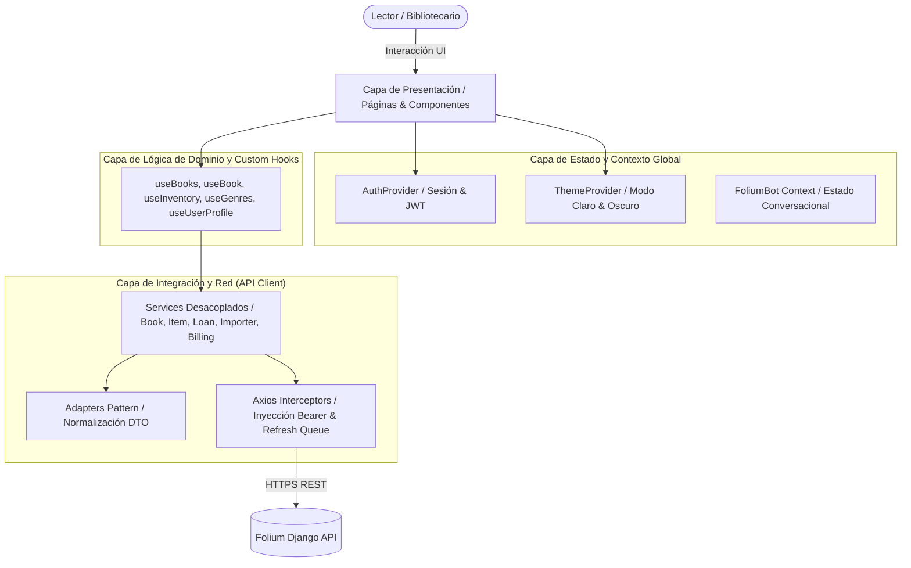
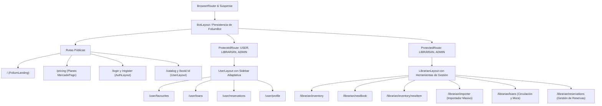

# Folium Web App — Plataforma Web de Gestión Curatorial y Catálogo Bibliográfico


---

## 1. Visión General del Proyecto

**Folium Web App** es la interfaz de usuario de la plataforma Folium, concebida para brindar una experiencia inmersiva, elegante y eficiente tanto a lectores como a equipos de bibliotecarios e investigadores.

La aplicación combina la calidez y el rigor de una biblioteca histórica con la velocidad de una **Single Page Application (SPA)** de última generación construida sobre **React 19** y **Vite 8**. Su estética se fundamenta en la corriente de diseño **"Dark Academia" y de archivo curatorial**, empleando tipografía clásica renacentista, encuadernación visual en pergamino y oro antiguo, contrastes profundos y animaciones fluidas basadas en físicas tridimensionales.

### Capacidades Principales
- **Exploración Tridimensional del Catálogo**: Carrusel circular CoverFlow en 3D con soporte de gestos táctiles (*swipe*) en dispositivos móviles y cuadrícula de obras con filtrado multicriterio instantáneo.
- **Asistente de Importación Masiva**: Asistente en 4 pasos para la carga de colecciones completas mediante planillas **Excel (.xlsx)**, archivos **CSV**, ficheros **BibTeX (.bib)** y registros estandarizados **MARC 21 (.mrc)** y **MARCXML (.xml)** con simulación previa (*dry-run*).
- **Gestión Integral de Circulación e Inventario**: Control de ejemplares físicos, ubicaciones topográficas en sala, supervisión de préstamos activos con cálculo de mora y sistema de reservas concurrentes.
- **Suscripciones y Facturación Institucional**: Integración con pasarela de **MercadoPago** para la contratación de planes bibliotecarios y cobro mensual.
- **Asistente Virtual Contextual (`FoliumBot` / Tomito)**: Chatbot persistente entre navegaciones que adapta sus respuestas y herramientas interactivas de acuerdo al rol del usuario activo.
- **Arquitectura de Sesión Segura y RBAC**: Autenticación JWT con cola de refresco transparente y protección jerárquica de vistas (`USER`, `LIBRARIAN`, `ADMIN`).

---

## 2. Arquitectura de Frontend y Patrones de Diseño

El proyecto implementa una **Arquitectura Modular Orientada a Responsabilidades (Responsibility-Driven Frontend Architecture)**, garantizando bajo acoplamiento, alta cohesión y testeabilidad.



### Patrones de Diseño Arquitectónicos

1. **Patrón Adapter (`src/api/adapters.js`)**:
   Desacopla la interfaz de usuario de las estructuras de datos devueltas por la API en Python (evitando la fuga de atributos en formato `snake_case` hacia los componentes). Transforma objetos crudos del backend en modelos de datos uniformes de frontend en `camelCase`, proveyendo valores por defecto seguros para portadas faltantes, listas de autores y disponibilidad.
2. **Patrón Concurrency-Safe Token Refresh Queue (`src/api/axiosConfig.js`)**:
   Implementa un interceptor de respuestas de Axios con cola de promesas. Cuando múltiples componentes disparan peticiones simultáneas y el token de acceso expira (`401 Unauthorized`), solo la primera petición gatilla el refresh contra `/token/refresh/`. Las demás peticiones se encolan automáticamente en memoria y se reintentan de forma transparente una vez recibido el nuevo token, sin forzar re-logins innecesarios.
3. **Patrón Composition con Layouts Anidados (`React Router v7`)**:
   Estructuración jerárquica de rutas mediante layouts especializados (`BotLayout`, `UserLayout`, `LibrarianLayout`, `AuthLayout`). `BotLayout` se sitúa en la raíz manteniendo la conversación y el estado del asistente virtual activos sin importar los cambios de ruta internos.
4. **Code-Splitting y Carga Perezosa (`React.lazy` + `Suspense`)**:
   Todas las páginas principales se cargan bajo demanda mediante importaciones dinámicas, reduciendo el tamaño del bundle inicial y alcanzando puntuaciones óptimas en Core Web Vitals (LCP e INP).
5. **Máquina de Estados Finita para Formularios Multietapa (`CatalogImporter`)**:
   El importador masivo modela su ciclo de vida en estados estrictos e irreversibles (`1: Selección de Archivo` → `2: Mapeo de Columnas` → `3: Simulación Dry-Run` → `4: Persistencia Final`), imposibilitando inconsistencias operativas.

---

## 3. Estructura de Directorios

```text
folium-web-app/
├── public/                               # Activos estáticos públicos y favicons
│   └── folium-logo-variants/             # Logotipos oficiales (blanco, negro, oro)
├── src/                                  # Código fuente de la aplicación
│   ├── api/                              # Capa de red y comunicación con la API REST
│   │   ├── services/                     # Servicios CRUD aislados por módulo
│   │   │   ├── authService.js            # Login JWT (/token/) y cierre de sesión
│   │   │   ├── authorService.js          # CRUD de autores
│   │   │   ├── billingService.js         # Planes institucionales y checkout MercadoPago
│   │   │   ├── bookService.js            # Obras literarias, portadas y recomendaciones
│   │   │   ├── genreService.js           # Géneros y categorías
│   │   │   ├── importerService.js        # Endpoints de importación masiva (preview, simulate, execute)
│   │   │   ├── itemService.js            # Ejemplares físicos e inventario en sala
│   │   │   ├── loanService.js            # Circulación, préstamos y devoluciones
│   │   │   ├── reservationService.js     # Solicitudes y cancelación de reservas
│   │   │   └── userService.js            # Registro, perfil y gestión de cuentas
│   │   ├── adapters.js                   # Adaptadores de datos Backend -> Frontend
│   │   ├── axiosConfig.js                # Instancia de Axios e interceptores JWT
│   │   └── constants.js                  # Constantes globales de dominio (estados de ítems, etc.)
│   ├── auth/                             # Módulo de autenticación y autorización
│   │   ├── AuthProvider.jsx              # Contexto global de sesión, decodificación de claims y estado
│   │   └── ProtectedRoute.jsx            # Guardia de rutas protegidas y filtro por rol (RBAC)
│   ├── chatbot/                          # Asistente virtual contextual FoliumBot (Tomito)
│   │   ├── ActionProvider.js             # Generador de respuestas y despachador de widgets
│   │   ├── FoliumBot.jsx                 # Contenedor flotante e inyección de contexto por rol
│   │   ├── MessageParser.js              # Procesador de lenguaje natural con reglas temáticas
│   │   ├── NavWidget.jsx                 # Botonera interactiva para redirección en un clic
│   │   └── config.jsx                    # Estilos visuales del bot y registro de widgets
│   ├── components/                       # Componentes visuales organizados por dominio
│   │   ├── BasicUIComponents/            # Primitivas de UI (Toast, FieldError, GoBackButton, etc.)
│   │   ├── BookCatalogComponents/        # Carrusel 3D (BookCoverFlow), BookCard y buscador
│   │   ├── BookDetailComponents/         # Metadatos, disponibilidad de stock físico y reseñas
│   │   ├── CatalogSearchComponents/      # Tarjetas de lista, cajón y barra lateral de filtros
│   │   ├── FoliumLandingComponents/      # Secciones de la Landing Page institucional
│   │   ├── InventoryComponents/          # Tabla de inventario, formularios de alta de libro y ejemplar
│   │   ├── Layouts/                      # BotLayout, UserLayout, LibrarianLayout, AuthLayout
│   │   ├── Login&RegisterComponents/     # Formularios de acceso y creación de cuentas
│   │   ├── ProfileComponents/            # Vista y edición de información de usuario
│   │   └── SideBar.jsx                   # Barra de navegación colapsable adaptativa por rol
│   ├── hooks/                            # Custom Hooks para fetching y lógica de negocio
│   │   ├── useBook.js                    # Consulta de obra individual por ID
│   │   ├── useBooks.js                   # Consulta paginada y filtrada del catálogo
│   │   ├── useGenres.js                  # Consulta de géneros
│   │   ├── useInventory.js               # Consulta de ejemplares físicos
│   │   └── useUserProfile.js             # Consulta y mutación del perfil en sesión
│   ├── pages/                            # Vistas principales asociadas al Router
│   │   ├── AddAnItem.jsx                 # Alta de nuevo ejemplar físico
│   │   ├── BookCatalog.jsx               # Catálogo general con CoverFlow 3D y búsqueda
│   │   ├── BookDetail.jsx                # Ficha técnica, estado de ejemplares y reseñas
│   │   ├── CatalogImporter.jsx           # Importador masivo (Excel, CSV, BibTeX, MARC 21, MARCXML)
│   │   ├── Error404.jsx                  # Página de ruta no encontrada
│   │   ├── Favourites.jsx                # Colección de favoritos del lector
│   │   ├── FoliumLanding.jsx             # Presentación institucional
│   │   ├── Inventory.jsx                 # Panel de inventario físico
│   │   ├── LibraryPricingPage.jsx        # Tarifas de planes y checkout con MercadoPago
│   │   ├── LoadBook.jsx                  # Catalogación de obra con subida de portadas
│   │   ├── LoansDashboard.jsx            # Panel de supervisión de préstamos y mora (Staff)
│   │   ├── Profile.jsx                   # Perfil del usuario autenticado
│   │   ├── ReservationDashboard.jsx      # Panel de reservas activas (Staff)
│   │   ├── Test.jsx                      # Sandbox de pruebas (disponible solo en DEV)
│   │   ├── UserLoans.jsx                 # Historial y préstamos activos del lector
│   │   └── UserReservations.jsx          # Reservas activas del lector
│   ├── theme/                            # Sistema de tematización (Claro / Oscuro)
│   │   ├── ThemeProvider.jsx             # Contexto de tema, persistencia en localStorage y media query
│   │   └── ThemeToggle.jsx               # Selector interactivo animado Sol/Luna
│   ├── App.css                           # Estilos auxiliares y animaciones clave
│   ├── App.jsx                           # Declaración central de rutas de React Router
│   ├── index.css                         # Definición de tokens de diseño en Tailwind v4 (@theme)
│   └── main.jsx                          # Punto de entrada del árbol DOM
├── eslint.config.js                      # Configuración de ESLint (Flat Config)
├── index.html                            # Plantilla HTML raíz
├── package.json                          # Dependencias de npm y scripts
├── vercel.json                           # Configuración de rewrites y CSP para Vercel
└── vite.config.js                        # Configuración de Vite y plugins oficiales
```

---

## 4. Sistema de Diseño "Dark Academia" y Design Tokens

Folium utiliza un sistema de diseño propio basado en **Tailwind CSS v4** mediante directivas `@theme`, evitando clases arbitrarias y unificando el lenguaje visual en toda la plataforma.

### Paleta Dual: Biblioteca Clásica vs. Espresso Profundo

| Token Semántico | Modo Claro ("Biblioteca Clásica") | Modo Oscuro ("Espresso Profundo") | Significado en el Sistema |
| :--- | :--- | :--- | :--- |
| `--color-background` | `#f0e3cc` (Parchment Luminoso) | `#1e1617` (Espresso Oscuro) | Fondo general del lienzo. |
| `--color-surface` | `#e0ceb4` (Parchment Base) | `#2b1f20` (Madera de Roble Tostada) | Paneles, tarjetas y modales. |
| `--color-surface-container-lowest` | `#fbf6ec` (Marfil Antiguo) | `#171112` (Negro Tinta) | Fondos de tablas y campos de entrada. |
| `--color-primary` | `#681822` (Burgundy Profundo) | `#e2b77a` / `#ba874b` (Oro Antiguo) | Botones primarios, destacados e isotipos. |
| `--color-on-primary` | `#f0e3cc` (Parchment) | `#1e1617` (Espresso) | Tipografía sobre botones primarios. |
| `--color-tertiary` | `#ba874b` (Antique Gold) | `#ba874b` (Oro Bruñido) | Acentos, bordes activos y medallas. |
| `--color-on-surface` | `#322325` (Tinta Espresso) | `#f0e3cc` (Parchment Suave) | Tipografía principal de lectura. |
| `--color-on-surface-variant`| `#4f6577` (Slate Blue Cúrcuma) | `#a99285` (Pergamino Envejecido) | Textos secundarios, metadatos y fechas. |
| `--color-outline-variant` | `#ccba9f` | `#3d2d2e` | Delimitadores y bordes sutiles. |

### Tipografía Curatorial

- **Titulares y Literatura (`--font-serif`)**: `EB Garamond Variable`, tipografía serif de inspiración clásica que aporta distinción editorial y calidez a los títulos, sinopsis y cabeceras.
- **Datos y Controles de Interfaz (`--font-sans`)**: `Hanken Grotesk Variable`, tipografía sans-serif de trazo geométrico y alta legibilidad para tablas de inventario, formularios densos y etiquetas de estado.

### Matemáticas del Carrusel 3D CoverFlow (`BookCoverFlow.jsx`)

El carrusel tridimensional calcula dinámicamente la posición espacial de cada libro en función de su distancia relativa al índice central activo (`offset = index - activeIndex`):
$$\text{transform} = \text{translateX}(offset \times 160\text{px}) \;\; \text{translateZ}(-|offset| \times 120\text{px}) \;\; \text{rotateY}(offset \times -28^\circ) \;\; \text{scale}(1 - |offset| \times 0.15)$$
- **Efecto de Profundidad**: Los libros laterales se comprimen visualmente en el eje Z y rotan hacia el centro como tomos en una estantería circular.
- **Soporte Móvil**: Detección de eventos táctiles `onTouchStart` y `onTouchEnd` para deslizamiento natural por gestos (*Swipe*).

---

## 5. Control de Navegación, Layouts y Matriz RBAC

La aplicación define un árbol de navegación seguro en [`src/App.jsx`](file:///c:/Users/Facundo/Desktop/ReposGit/folium-web-app/src/App.jsx) validado por [`src/auth/ProtectedRoute.jsx`](file:///c:/Users/Facundo/Desktop/ReposGit/folium-web-app/src/auth/ProtectedRoute.jsx):



### Tabla Completa de Rutas y Permisos

| Ruta | Componente | Layout | Acceso | Propósito |
| :--- | :--- | :--- | :--- | :--- |
| `/` | `FoliumLanding` | Directo | Público | Página de bienvenida con recomendaciones aleatorias y accesos rápidos. |
| `/pricing` | `LibraryPricingPage` | `BotLayout` | Público | Catálogo interactivo de suscripciones y checkout directo con MercadoPago. |
| `/login` | `LoginForm` | `BotLayout` > `AuthLayout` | Público | Autenticación JWT para lectores y personal. |
| `/register` | `RegisterForm` | `BotLayout` > `AuthLayout` | Público | Creación de cuenta de lector con DNI único. |
| `/catalog` | `BookCatalog` | `BotLayout` > `UserLayout` | Público / Todos | Catálogo con carrusel 3D, filtros laterales y paginación de 20 obras. |
| `/book/:id` | `BookDetail` | `BotLayout` > `UserLayout` | Público / Todos | Ficha técnica, disponibilidad física en sala y valoraciones. |
| `/user/favourites` | `Favourites` | `BotLayout` > `UserLayout` | `USER`, `LIBRARIAN`, `ADMIN` | Colección personal de libros guardados por el lector. |
| `/user/loans` | `UserLoans` | `BotLayout` > `UserLayout` | `USER`, `LIBRARIAN`, `ADMIN` | Listado de libros en poder del lector con días restantes para devolución. |
| `/user/reservations` | `UserReservations` | `BotLayout` > `UserLayout` | `USER`, `LIBRARIAN`, `ADMIN` | Reservas pendientes y confirmadas del lector con opción de cancelación. |
| `/user/profile` | `Profile` | `BotLayout` > `UserLayout` | `USER`, `LIBRARIAN`, `ADMIN` | Datos de cuenta, estadísticas de lectura y edición de perfil. |
| `/librarian/inventory` | `Inventory` | `BotLayout` > `LibrarianLayout` | `LIBRARIAN`, `ADMIN` | Tabla de ejemplares físicos, códigos de inventario y estado. |
| `/librarian/newBook` | `LoadBook` | `BotLayout` > `LibrarianLayout` | `LIBRARIAN`, `ADMIN` | Formulario de alta con previsualización de portada y creación en línea de autores/géneros. |
| `/librarian/inventory/newItem` | `AddAnItem` | `BotLayout` > `LibrarianLayout` | `LIBRARIAN`, `ADMIN` | Asignación de un nuevo ejemplar físico con ubicación en sala. |
| `/librarian/importer` | `CatalogImporter` | `BotLayout` > `LibrarianLayout` | `LIBRARIAN`, `ADMIN` | Asistente en 4 pasos para importación de Excel, CSV, BibTeX y MARC 21 / MARCXML. |
| `/librarian/loans` | `LoansDashboard` | `BotLayout` > `LibrarianLayout` | `LIBRARIAN`, `ADMIN` | Supervisión de préstamos activos, cálculo de mora y devolución de ejemplares en un clic. |
| `/librarian/reservations` | `ReservationDashboard` | `BotLayout` > `LibrarianLayout` | `LIBRARIAN`, `ADMIN` | Monitoreo y resolución de solicitudes de reserva de la biblioteca. |
| `*` | `Error404` | `BotLayout` | Público | Pantalla de error con diseño editorial y botón de retorno. |

---

## 6. Módulos Funcionales Destacados

### 1. Importador Masivo de Catálogos (`CatalogImporter.jsx`)
- **Paso 1: Selección y Detección de Formato**: Zona de carga por arrastre (*drag-and-drop*) con soporte universal para `.xlsx`, `.csv`, `.tsv`, `.txt`, `.bib`, `.mrc`, `.marc`, `.xml`, `.marcxml`. Cuenta con botones de descarga de plantillas de ejemplo listas para usar (incluyendo binarios MARC 21 codificados en Base64 y MARCXML oficiales).
- **Paso 2: Vista Previa y Mapeo Inteligente**: Lee las primeras filas del archivo y preasigna automáticamente las columnas a los campos obligatorios de Folium (`title`, `author`, `isbn`, `editorial`, `year`, `genre`, `inventory_code`, `location`, `description`).
- **Paso 3: Simulación Dry-Run**: Muestra un desglose previo del total de filas procesadas, registros válidos, filas con advertencias y errores críticos antes de tocar la base de datos.
- **Paso 4: Confirmación y Resumen Transaccional**: Ejecución atómica que informa la cantidad exacta de obras nuevas incorporadas, ejemplares físicos etiquetados y filas omitidas.

### 2. Circulación y Préstamos (`LoansDashboard.jsx`)
- **Control de Vencimientos en Tiempo Real**: Cálculo visual con insignias de estado (Verde: *Más de 3 días*, Amarillo: *Próximo a vencer*, Rojo pulsante: *Vencido con mora calculada*).
- **Devolución Rápida**: Botón de confirmación que invoca `POST /loan/{id}/return_book/`, liberando el ejemplar a estado `AVAILABLE` de forma inmediata.

### 3. Asistente Virtual Inteligente (`FoliumBot.jsx`)
- **Conciencia de Rol**: Si el usuario es un lector (`USER`), ofrece sugerencias literarias, ayuda para renovar préstamos y búsqueda en el catálogo. Si es bibliotecario (`LIBRARIAN`), habilita accesos directos al importador masivo, auditoría de inventario y panel de mora.
- **Persistencia**: Diseñado sobre `BotLayout`, manteniendo el historial de la conversación intacto aunque el usuario cambie de ruta en la aplicación.

---

## 7. Configuración de Entorno y Variables

Crear un archivo `.env` en la raíz de `folium-web-app` basándose en `.env.example`:

```bash
# URL Base de la API REST de Django
VITE_API_BASE_URL=http://localhost:8080/api/v1

# Clave pública de MercadoPago (para inicialización del SDK de frontend si aplica)
VITE_MERCADOPAGO_PUBLIC_KEY=APP_USR-xxxx-xxxx-xxxx
```

---

## 8. Guía de Instalación, Desarrollo y Compilación

### Requisitos Previos
- **Node.js**: Versión `20.x` o superior.
- **npm**: Versión `10.x` o superior.

### Comandos de Ejecución

```bash
# 1. Instalar dependencias del proyecto
npm install

# 2. Iniciar servidor de desarrollo con Hot Module Replacement (HMR)
npm run dev

# 3. Compilar la aplicación para producción (Bundle optimizado en dist/)
npm run build

# 4. Previsualizar localmente el build de producción
npm run preview

# 5. Ejecutar análisis estático de código con ESLint
npm run lint
```

---

## 9. Despliegue en Producción (Vercel)

La aplicación está preparada para su despliegue continuo en **Vercel** mediante el archivo de configuración [`vercel.json`](file:///c:/Users/Facundo/Desktop/ReposGit/folium-web-app/vercel.json):
- **Reglas de Reescritura SPA**: Redirige todas las rutas solicitadas hacia `index.html` para permitir el enrutamiento del lado del cliente (`client-side routing`).
- **Políticas de Seguridad de Contenido (CSP)**: Permite la conexión segura con los servidores de la API REST, CDNs de fuentes tipográficas (`Google Fonts`, `Fontsource`) y el SDK de MercadoPago.
- **Control de Caché de Activos**: Los archivos estáticos versionados dentro de `assets/` cuentan con encabezados de caché inmutable (`max-age=31536000, immutable`), mientras que `index.html` se sirve siempre actualizado para evitar estados desfasados tras nuevos despliegues.
