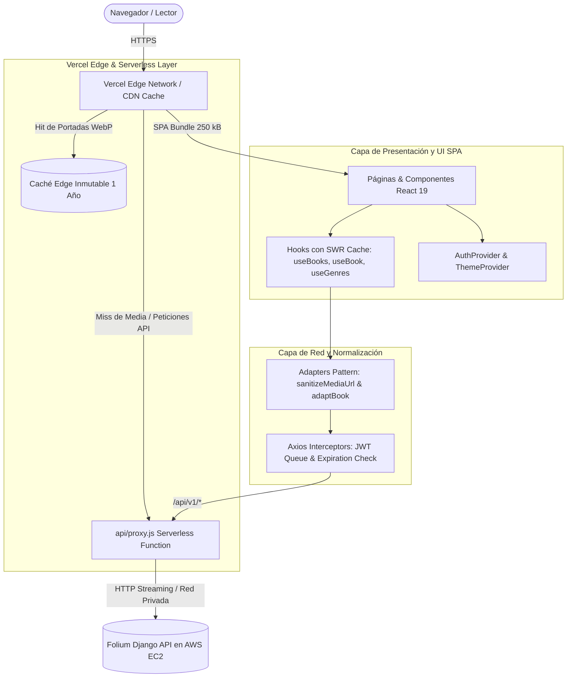
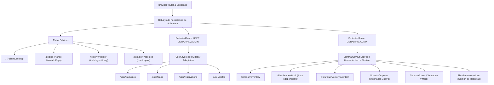

# Folium Web App — Plataforma Web de Gestión Curatorial y Catálogo Bibliográfico


-success?style=for-the-badge&logo=rollup.js&logoColor=white)

---

## 1. Visión General del Proyecto

**Folium Web App** es la interfaz de usuario de la plataforma Folium, concebida para brindar una experiencia inmersiva, elegante y de máximo rendimiento tanto a lectores como a equipos de bibliotecarios e investigadores.

La aplicación combina la calidez y el rigor de una biblioteca histórica con la velocidad de una **Single Page Application (SPA)** de última generación construida sobre **React 19** y **Vite 8**. Su estética se fundamenta en la corriente de diseño **"Dark Academia" y de archivo curatorial**, empleando tipografía clásica renacentista, encuadernación visual en pergamino y oro antiguo, contrastes profundos y animaciones fluidas basadas en físicas tridimensionales.

### Capacidades Principales
- **Exploración Tridimensional del Catálogo**: Carrusel circular CoverFlow en 3D con soporte de gestos táctiles (*swipe*) en dispositivos móviles y cuadrícula de obras con filtrado multicriterio instantáneo.
- **Entrega Ultrarrápida por Edge CDN**: Servido de portadas optimizadas en WebP con almacenamiento en caché inmutable en los nodos de borde de Vercel y resolución transparente de *Mixed Content*.
- **Navegación Instantánea con SWR**: Caché en memoria Stale-While-Revalidate en hooks de datos (`useBooks`, `useBook`, `useGenres`, `useRecommendations`), eliminando parpadeos y transiciones destructivas de UI.
- **Asistente de Importación Masiva**: Asistente en 4 pasos para la carga de colecciones completas mediante planillas **Excel (.xlsx)**, archivos **CSV**, ficheros **BibTeX (.bib)** y registros estandarizados **MARC 21 (.mrc)** y **MARCXML (.xml)** con simulación previa (*dry-run*).
- **Gestión Integral de Circulación e Inventario**: Control de ejemplares físicos, ubicaciones topográficas en sala, supervisión de préstamos activos con cálculo de mora y sistema de reservas concurrentes.
- **Suscripciones y Facturación Institucional**: Integración con pasarela de **MercadoPago** para la contratación de planes bibliotecarios y cobro mensual.
- **Asistente Virtual Contextual (`FoliumBot` / Tomito)**: Chatbot persistente entre navegaciones que adapta sus respuestas y herramientas interactivas de acuerdo al rol del usuario activo.
- **Arquitectura de Sesión Segura y RBAC**: Autenticación JWT con cola de refresco concurrente, validación de expiración de tokens al cargar y protección jerárquica de vistas (`USER`, `LIBRARIAN`, `ADMIN`).

---

## 2. Arquitectura de Frontend y Patrones de Diseño

El proyecto implementa una **Arquitectura Modular Orientada a Responsabilidades (Responsibility-Driven Frontend Architecture)**, complementada por una capa perimetral de **Vercel Serverless & Edge CDN Proxy**.



### Patrones de Diseño y Optimizaciones Arquitectónicas

1. **Proxy Reverso Serverless y Edge CDN Caching (`api/proxy.js`)**:
   - **Prevención de Mixed Content**: El backend en AWS EC2 se aloja bajo HTTP (`http://54.160.130.29`), mientras que el frontend en Vercel opera bajo HTTPS estricto. La función serveless en streaming actúa como pasarela segura.
   - **Caché en el Borde Inmutable**: Las portadas `/media/books/covers/*` se entregan con `Cache-Control: public, max-age=31536000, s-maxage=31536000, stale-while-revalidate=2592000, immutable`, `CDN-Cache-Control` y `Vercel-CDN-Cache-Control`. Una vez consultada por primera vez, la portada se sirve directamente desde el nodo Edge más cercano en ~15 ms sin tocar la Serverless Function ni el servidor EC2.
   - **Streaming Asíncrono de Bajo Consumo**: Utiliza `Readable.fromWeb()` y `pipeline()` de Node.js, logrando un TTFB mínimo y un consumo casi nulo de memoria RAM.
2. **Cache-Busting Inteligente (`src/api/adapters.js`)**:
   [`sanitizeMediaUrl(url, book.updated_at)`](file:///c:/Users/Facundo/Desktop/ReposGit/folium-web-app/src/api/adapters.js) transforma las URLs de portadas y adjunta el parámetro de versión `?v=<timestamp>`. Cuando un bibliotecario edita la portada de una obra, el navegador y el CDN de Vercel descargan de inmediato la nueva versión sin requerir purgas manuales de caché.
3. **Optimización Extrema del Bundle JS (-71% de Peso)**:
   - Eliminación de dependencias monolíticas redundantes (`morphicons`, `lucide` vanilla).
   - Actualización a `lucide-react@^1.66` con árbol de importaciones ESM (`import { ... } from "lucide-react"`), permitiendo a Vite aplicar *tree-shaking* estricto.
   - El bundle principal de producción (`dist/assets/index.js`) se redujo de **860 kB a 250 kB**.
4. **Subsetting de Tipografías Web**:
   En [`src/fonts.css`](file:///c:/Users/Facundo/Desktop/ReposGit/folium-web-app/src/fonts.css), se aislaron exclusivamente los subconjuntos tipográficos `latin` y `latin-ext` para `EB Garamond` y `Hanken Grotesk`, reduciendo los activos de fuentes de 21 archivos `.woff2` a solo 8 archivos `.woff2`.
5. **Caché en Memoria Stale-While-Revalidate (SWR)**:
   Los hooks de datos (`useBooks.js`, `useBook.js`, `useGenres.js`, `useRecommendations.js`) implementan un almacén global en memoria con estrategia SWR. Cuando el usuario navega entre libros o vuelve al catálogo, los datos se despliegan de forma instantánea desde la memoria mientras se revalidan en segundo plano de manera no destructiva.
6. **Búsqueda No Destructiva con Skeletons**:
   En [`CatalogSearch.jsx`](file:///c:/Users/Facundo/Desktop/ReposGit/folium-web-app/src/components/BookCatalogComponents/CatalogSearch.jsx), se reemplazó el desmontaje del árbol DOM por una cuadrícula de esqueletos animados (`CatalogSkeletonGrid`) y transiciones de opacidad suave durante el refresco (`isFetching`), evitando que el input de búsqueda pierda foco mientras el usuario escribe.
7. **Tolerancia a Fallos y Fallback de Editoriales**:
   En [`useEditorials.js`](file:///c:/Users/Facundo/Desktop/ReposGit/folium-web-app/src/hooks/useEditorials.js), si el endpoint `/api/v1/editorial/` responde `404` (por desfase temporal en el despliegue del backend), el hook extrae automáticamente las editoriales únicas a partir del catálogo de libros (`bookService.getAll({ page_size: 50 })`), garantizando que los desplegables de alta de libro nunca queden vacíos.

---

## 3. Estructura de Directorios

```text
folium-web-app/
├── api/
│   └── proxy.js                          # Vercel Serverless Function (Proxy API y Edge CDN Media)
├── public/                               # Activos estáticos públicos y favicons
│   └── folium-logo-variants/             # Logotipos oficiales (blanco, negro, oro)
├── src/                                  # Código fuente de la aplicación
│   ├── api/                              # Capa de red y comunicación con la API REST
│   │   ├── services/                     # Servicios CRUD aislados por módulo
│   │   │   ├── authService.js            # Login JWT (/token/) y cierre de sesión
│   │   │   ├── authorService.js          # CRUD de autores
│   │   │   ├── billingService.js         # Planes institucionales y checkout MercadoPago
│   │   │   ├── bookService.js            # Obras literarias, portadas y recomendaciones
│   │   │   ├── editorialService.js       # Endpoints de editoriales registradas
│   │   │   ├── genreService.js           # Géneros y materias
│   │   │   ├── importerService.js        # Motor de importación masiva
│   │   │   ├── itemService.js            # Ejemplares físicos e inventario en sala
│   │   │   ├── loanService.js            # Circulación, préstamos y devoluciones
│   │   │   ├── reservationService.js     # Solicitudes y cancelación de reservas
│   │   │   └── userService.js            # Registro, perfil y gestión de cuentas
│   │   ├── adapters.js                   # Adaptadores DTO, saneamiento de URLs y cache-busting
│   │   ├── axiosConfig.js                # Instancia de Axios con cola de refresco concurrente
│   │   └── constants.js                  # Constantes globales de dominio (estados de ítems, etc.)
│   ├── auth/                             # Módulo de autenticación y autorización
│   │   ├── AuthProvider.jsx              # Contexto de sesión, validación de exp y decodificación
│   │   └── ProtectedRoute.jsx            # Guardia de rutas protegidas y filtro RBAC
│   ├── chatbot/                          # Asistente virtual contextual FoliumBot (Tomito)
│   ├── components/                       # Componentes visuales organizados por dominio
│   │   ├── BasicUIComponents/            # Primitivas de UI (Toast, FieldError, GoBackButton, etc.)
│   │   ├── BookCatalogComponents/        # Carrusel 3D (BookCoverFlow), BookCard y CatalogSearch
│   │   ├── BookDetailComponents/         # Metadatos, disponibilidad de stock físico y reseñas
│   │   ├── CatalogSearchComponents/      # Tarjetas de lista, cajón y barra lateral de filtros
│   │   ├── FoliumLandingComponents/      # Secciones de la Landing Page institucional
│   │   ├── InventoryComponents/          # Tabla de inventario, LoadBookForm y modal de ejemplar
│   │   ├── Layouts/                      # BotLayout, UserLayout, LibrarianLayout, AuthLayout
│   │   ├── Login&RegisterComponents/     # Formularios de acceso y creación de cuentas
│   │   ├── ProfileComponents/            # Vista y edición de información de usuario
│   │   └── SideBar.jsx                   # Barra de navegación colapsable adaptativa por rol
│   ├── hooks/                            # Custom Hooks con soporte de caché SWR
│   │   ├── useBook.js                    # Consulta de obra individual por ID con SWR
│   │   ├── useBooks.js                   # Consulta paginada y filtrada del catálogo con SWR
│   │   ├── useEditorials.js              # Consulta de editoriales con fallback inteligente
│   │   ├── useGenres.js                  # Consulta de géneros con SWR
│   │   ├── useInventory.js               # Consulta de ejemplares físicos
│   │   ├── useRecommendations.js         # Recomendaciones literarias con SWR
│   │   └── useUserProfile.js             # Consulta y mutación del perfil en sesión
│   ├── pages/                            # Vistas principales asociadas al Router
│   │   ├── AddAnItem.jsx                 # Alta de nuevo ejemplar físico
│   │   ├── BookCatalog.jsx               # Catálogo general con CoverFlow 3D y búsqueda
│   │   ├── BookDetail.jsx                # Ficha técnica, estado de ejemplares y reseñas
│   │   ├── CatalogImporter.jsx           # Importador masivo (Excel, CSV, BibTeX, MARC 21, MARCXML)
│   │   ├── Error404.jsx                  # Página de ruta no encontrada
│   │   ├── Favourites.jsx                # Colección de favoritos del lector
│   │   ├── FoliumLanding.jsx             # Presentación institucional
│   │   ├── Inventory.jsx                 # Panel de inventario físico
│   │   ├── LibraryPricingPage.jsx        # Tarifas de planes y checkout con MercadoPago
│   │   ├── LoadBook.jsx                  # Catalogación de obra con subida de portadas
│   │   ├── LoansDashboard.jsx            # Panel de supervisión de préstamos y mora (Staff)
│   │   ├── Profile.jsx                   # Perfil del usuario autenticado
│   │   ├── ReservationDashboard.jsx      # Panel de reservas activas (Staff)
│   │   ├── UserLoans.jsx                 # Historial y préstamos activos del lector
│   │   └── UserReservations.jsx          # Reservas activas del lector
│   ├── theme/                            # Sistema de tematización (Claro / Oscuro)
│   ├── App.jsx                           # Declaración central de rutas de React Router
│   ├── fonts.css                         # Subsetting selectivo de fuentes Latin y Latin-Ext
│   ├── index.css                         # Tokens de diseño en Tailwind v4 (@theme)
│   └── main.jsx                          # Punto de entrada del árbol DOM
├── vercel.json                           # Configuración de CSP, Rewrites y Edge CDN Caching
└── vite.config.js                        # Configuración de Vite y plugins oficiales
```

---

## 4. Sistema de Diseño "Dark Academia" y Design Tokens

Folium utiliza un sistema de diseño propio basado en **Tailwind CSS v4** mediante directivas `@theme`:

### Paleta Dual: Biblioteca Clásica vs. Espresso Profundo

| Token Semántico | Modo Claro ("Biblioteca Clásica") | Modo Oscuro ("Espresso Profundo") | Significado en el Sistema |
| :--- | :--- | :--- | :--- |
| `--color-background` | `#f0e3cc` (Parchment Luminoso) | `#1e1617` (Espresso Oscuro) | Fondo general del lienzo. |
| `--color-surface` | `#e0ceb4` (Parchment Base) | `#2b1f20` (Madera de Roble Tostada) | Paneles, tarjetas y modales. |
| `--color-surface-container-lowest` | `#fbf6ec` (Marfil Antiguo) | `#171112` (Negro Tinta) | Fondos de tablas y campos de entrada. |
| `--color-primary` | `#681822` (Burgundy Profundo) | `#e2b77a` / `#ba874b` (Oro Antiguo) | Botones primarios, destacados e isotipos. |
| `--color-on-primary` | `#f0e3cc` (Parchment) | `#1e1617` (Espresso) | Tipografía sobre botones primarios. |
| `--color-tertiary` | `#ba874b` (Antique Gold) | `#ba874b` (Oro Bruñido) | Acentos, bordes activos y medallas. |
| `--color-on-surface` | `#322325` (Tinta Espresso) | `#f0e3cc` (Parchment Suave) | Tipografía principal de lectura. |
| `--color-on-surface-variant`| `#4f6577` (Slate Blue Cúrcuma) | `#a99285` (Pergamino Envejecido) | Textos secundarios, metadatos y fechas. |
| `--color-outline-variant` | `#ccba9f` | `#3d2d2e` | Delimitadores y bordes sutiles. |

### Tipografía Curatorial

- **Titulares y Literatura (`--font-serif`)**: `EB Garamond Variable` (subconjuntos `latin` y `latin-ext`).
- **Datos y Controles de Interfaz (`--font-sans`)**: `Hanken Grotesk Variable` (subconjuntos `latin` y `latin-ext`).

---

## 5. Control de Navegación, Layouts y Matriz RBAC

La aplicación define un árbol de navegación seguro en [`src/App.jsx`](file:///c:/Users/Facundo/Desktop/ReposGit/folium-web-app/src/App.jsx) validado por [`src/auth/ProtectedRoute.jsx`](file:///c:/Users/Facundo/Desktop/ReposGit/folium-web-app/src/auth/ProtectedRoute.jsx):



### Tabla Completa de Rutas y Permisos

| Ruta | Componente | Layout | Acceso | Propósito |
| :--- | :--- | :--- | :--- | :--- |
| `/` | `FoliumLanding` | Directo | Público | Página de bienvenida con recomendaciones aleatorias y accesos rápidos. |
| `/pricing` | `LibraryPricingPage` | `BotLayout` | Público | Catálogo interactivo de suscripciones y checkout directo con MercadoPago. |
| `/login` | `LoginForm` | `BotLayout` > `AuthLayout` (Lazy) | Público | Autenticación JWT para lectores y personal. |
| `/register` | `RegisterForm` | `BotLayout` > `AuthLayout` (Lazy) | Público | Creación de cuenta de lector con DNI único. |
| `/catalog` | `BookCatalog` | `BotLayout` > `UserLayout` | Público / Todos | Catálogo con carrusel 3D, filtros laterales y navegación directa a detalle. |
| `/book/:id` | `BookDetail` | `BotLayout` > `UserLayout` | Público / Todos | Ficha técnica, disponibilidad física en sala y valoraciones. |
| `/user/favourites` | `Favourites` | `BotLayout` > `UserLayout` | `USER`, `LIBRARIAN`, `ADMIN` | Colección personal de libros guardados por el lector. |
| `/user/loans` | `UserLoans` | `BotLayout` > `UserLayout` | `USER`, `LIBRARIAN`, `ADMIN` | Listado de libros en poder del lector con días restantes para devolución. |
| `/user/reservations` | `UserReservations` | `BotLayout` > `UserLayout` | `USER`, `LIBRARIAN`, `ADMIN` | Reservas pendientes y confirmadas del lector con opción de cancelación. |
| `/user/profile` | `Profile` | `BotLayout` > `UserLayout` | `USER`, `LIBRARIAN`, `ADMIN` | Datos de cuenta, estadísticas de lectura y edición de perfil. |
| `/librarian/inventory` | `Inventory` | `BotLayout` > `LibrarianLayout` (Lazy) | `LIBRARIAN`, `ADMIN` | Tabla de ejemplares físicos, códigos de inventario y estado. |
| `/librarian/newBook` | `LoadBook` | `BotLayout` > `LibrarianLayout` (Lazy) | `LIBRARIAN`, `ADMIN` | Formulario de alta con selector de editoriales, previsualización y compresión WebP. |
| `/librarian/inventory/newItem` | `AddAnItem` | `BotLayout` > `LibrarianLayout` (Lazy) | `LIBRARIAN`, `ADMIN` | Asignación de un nuevo ejemplar físico con ubicación en sala. |
| `/librarian/importer` | `CatalogImporter` | `BotLayout` > `LibrarianLayout` (Lazy) | `LIBRARIAN`, `ADMIN` | Asistente en 4 pasos para importación de Excel, CSV, BibTeX y MARC 21 / MARCXML. |
| `/librarian/loans` | `LoansDashboard` | `BotLayout` > `LibrarianLayout` (Lazy) | `LIBRARIAN`, `ADMIN` | Supervisión de préstamos activos, cálculo de mora y devolución de ejemplares en un clic. |
| `/librarian/reservations` | `ReservationDashboard` | `BotLayout` > `LibrarianLayout` (Lazy) | `LIBRARIAN`, `ADMIN` | Monitoreo y resolución de solicitudes de reserva de la biblioteca. |
| `*` | `Error404` | `BotLayout` | Público | Pantalla de error con diseño editorial y botón de retorno. |

---

## 6. Configuración de Entorno y Variables

Crear un archivo `.env` en la raíz de `folium-web-app` basándose en `.env.example`:

```bash
# URL Base de la API REST (en desarrollo local)
VITE_API_BASE_URL=http://localhost:8080/api/v1

# Clave pública de MercadoPago (para checkout)
VITE_MERCADOPAGO_PUBLIC_KEY=APP_USR-xxxx-xxxx-xxxx
```

En entornos de producción desplegados en Vercel, la variable `BACKEND_HOST` se configura en el panel de control de Vercel apuntando al servidor backend (por defecto `http://54.160.130.29`), mientras que el frontend consume la API a través del proxy relativo `/api/v1` y las imágenes por `/media/...`.

---

## 7. Guía de Instalación, Desarrollo y Compilación

### Requisitos Previos
- **Node.js**: Versión `20.x` o superior.
- **npm**: Versión `10.x` o superior.

### Comandos de Ejecución

```bash
# 1. Instalar dependencias del proyecto
npm install

# 2. Iniciar servidor de desarrollo con Hot Module Replacement (HMR)
npm run dev

# 3. Compilar la aplicación para producción (Bundle optimizado de ~250 kB en dist/)
npm run build

# 4. Previsualizar localmente el build de producción
npm run preview

# 5. Ejecutar análisis estático de código con ESLint
npm run lint
```

---

## 8. Despliegue en Producción (Vercel)

La aplicación está completamente configurada para despliegue continuo en **Vercel** mediante [`vercel.json`](file:///c:/Users/Facundo/Desktop/ReposGit/folium-web-app/vercel.json):
- **Edge CDN Caching para Imágenes**: Las rutas `/media/(.*)` se reescriben a `api/proxy.js` y cuentan con cabeceras `Cache-Control: public, max-age=31536000, s-maxage=31536000, stale-while-revalidate=2592000, immutable`.
- **Content Security Policy (CSP) Permisiva y Segura**:
  - `font-src`: Autoriza fuentes locales, `https://fonts.gstatic.com`, `https://assets.vercel.com` y `https://*.vercel.live` (evitando bloqueos en Vercel Preview Toolbar).
  - `connect-src`: Habilita la IP del backend, dominios Vercel y WebSockets de Pusher (`wss://*.pusher.com`).
  - `script-src` y `frame-src`: Habilita scripts esenciales y herramientas de auditoría en vivo.
- **Reglas de Reescritura SPA**: Cualquier ruta que no sea un recurso estático ni una llamada a `/api/` o `/media/` se redirige a `/index.html` para el correcto funcionamiento del router del cliente.
