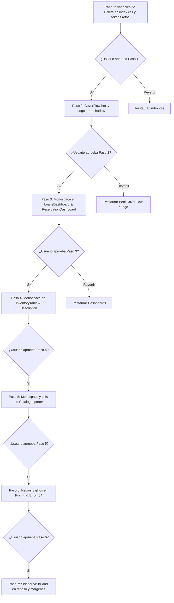

# Documento de Diseño: Purificación Editorial UI/UX y Erradicación de Tells de IA

- **Proyecto**: Folium (`folium-web-app`)
- **Fecha**: 2026-11-04
- **Estado**: Propuesto (En revisión)
- **Estrategia**: Enfoque 1 (Purificación Editorial Integral), ejecutado en **Ciclo 1: 7 micro-pasos incrementales reversibles** (focalizados en el sistema global de tokens, catálogo, navegación lateral, precios y dashboards de administración clave; las vistas secundarias de lector y modales se abordarán en un ciclo complementario).

---

## 1. Contexto e Intención

Folium es una plataforma de preservación y gestión bibliotecaria inspirada en archivos documentales históricos y bibliotecas patrimoniales. 

La auditoría visual realizada con `taste-skill` y `ui-visual-validator` reveló una serie de incongruencias cromáticas (azul pizarra frío `#4f6577` sobre pergamino cálido `#f0e3cc`), fallas severas de contraste WCAG AA (< 3:1), colores fijos que rompen el tema oscuro en el Coverflow, y una acumulación de **404 fallos de tells de IA** (destacando **144 usos de `font-mono`** en tablas, folios y fechas, y **121 micro-etiquetas** en mayúsculas forzadas).

El usuario ha seleccionado el **Enfoque 1 (Purificación Integral)** con una condición operativa estricta:
> *"vamos de a poco con el Enfoque 1. quiero ir haciendo cambios muy pequeños para poder ver el resultado y decidir si volver a dejarlo como estaba antes o continuar con el siguiente paso."*

Por ende, este diseño estructura la purificación en **micro-pasos atómicos, aislados y verificables** en el navegador.

---

## 2. Objetivos, No-Objetivos y Anti-Objetivos

### Objetivos
1. **Accesibilidad y Contraste WCAG AA**:
   - Todo texto de cuerpo y datos secundarios debe cumplir un ratio de contraste mínimo de **4.5:1** (preferentemente > 7:1) contra sus fondos tanto en modo claro como en modo oscuro.
   - Sustituir el Slate Blue frío (`#4f6577`) por una tinta Espresso cálida y armónica (`#4a383b` en modo claro y `#c8b79f` en modo oscuro).
2. **Erradicación de "Tells" de IA y Monospace**:
   - Reemplazar el monospace (`font-mono`) en tablas, signaturas, fechas y folios por tipografía sans-serif con cifras tabulares (`font-sans tabular-nums`).
   - Eliminar micro-etiquetas tracking-widest, glifos cosméticos (`✦`, `❦`), doble barra `//` y status dots palpitantes (`animate-pulse`).
3. **Consistencia de Sistema de Diseño**:
   - Reemplazar tokens inexistentes (`tertiary-fixed`).
   - Normalizar los radios de borde en la página de precios (cambiar `rounded-3xl` y píldoras `rounded-full` de estética SaaS genérica por `rounded-sm`/`rounded-md`).
   - Unificar los botones de acción para que el avance de flujo use de forma consistente el color primario de la marca (Burgundy en claro, Antique Gold en oscuro).
4. **Flujo de Trabajo Incremental y Reversible**:
   - Cada cambio se implementa en un paso atómico de 1 a 3 archivos.
   - Se valida la compilación con `npm.cmd run build`.
   - Se presenta el resultado al usuario para inspección visual y decisión de confirmación o reversión antes de avanzar al siguiente paso.

### No-Objetivos
- No se modificará el backend (`folium-api`), ni modelos, endpoints ni migraciones de base de datos.
- No se eliminará la navegación interactiva Coverflow 3D ni el chatbot, solo se higienizarán sus estilos y colores.
- No se realizarán cambios de dependencias en `package.json`.

### Anti-Objetivos
- **No hacer un commit masivo o "Big Bang"**: Ningún paso tocará más componentes de los estrictamente delimitados.
- **No romper la legibilidad ni la funcionalidad existente**: Toda acción de reserva, préstamo, filtro o importación debe conservar el 100% de su comportamiento.

---

## 3. Enfoques Considerados y Selección

1. **Enfoque 1: Purificación Editorial Integral (Seleccionado)**: Resuelve paleta, tipografía tabular, contraste WCAG y unificación de componentes en toda la aplicación. Se ejecutará mediante micro-pasos guiados.
2. **Enfoque 2: Saneamiento en Dos Grandes Bloques**: Descartado por el usuario en favor del avance gradual paso a paso.
3. **Enfoque 3: Mínimo Cosmetológico**: Descartado porque mantenía intacta la deuda visual de 404 fallos de tells y los estilos discordantes.

---

## 4. Secuencia de Micro-Pasos para Ejecución

### Detalle de cada Micro-Paso

#### Paso 1: Higiene Central de Tokens y Contraste de Paleta (`index.css`)
- **Archivos**: `folium-web-app/src/index.css`, `folium-web-app/src/pages/BookDetail.jsx`, `folium-web-app/src/components/InventoryComponents/InventoryTable.jsx`.
- **Acción**:
  - Reemplazar `--color-on-surface-variant: #4f6577` (Slate Blue) por `#4a383b` en modo claro (contraste **7.8:1** sobre `#f0e3cc`) y `#c8b79f` en modo oscuro (contraste **7.2:1** sobre `#1c1314`).
  - **Diferenciación semántica de estados de inventario (Decisión de diseño)**:
    - `ITEM_STATUS.AVAILABLE`: `bg-surface-container-high text-on-surface border border-outline-variant/50` (neutro archivístico disponible).
    - `ITEM_STATUS.LOANED` / `RESERVED`: `bg-secondary-container/40 text-on-surface border border-secondary/30` (tono cálido reservado/en tránsito).
    - `ITEM_STATUS.DAMAGED` / `LOST`: `bg-error-container/30 text-error border border-error/30` (alerta de conservación física).
    Esto erradica el token inválido `tertiary-fixed` sin unificar visualmente ejemplares disponibles y no disponibles.
- **Verificación**: `npm.cmd run build` y comprobación de contraste en textos secundarios de fichas y tablas.

#### Paso 2: Eliminación de Hex Fijos en CoverFlow y Logo
- **Archivos**: `folium-web-app/src/components/BookCatalogComponents/BookCoverFlow.jsx`, `folium-web-app/src/components/BasicUIComponents/FoliumFullLogo.jsx`.
- **Acción**:
  - Reemplazar en las flechas y paginación de `BookCoverFlow.jsx` los colores fijos (`#ede6d3`, `#5c1616`, etc.) por `bg-surface-container border border-outline-variant text-primary` con soporte transparente para modo oscuro.
  - Retirar el `drop-shadow` blanco hardcodeado de `FoliumFullLogo.jsx` y enlazar `colorLogo` a `var(--color-primary)` por defecto.
- **Verificación**: Verificación visual de los botones del carrusel en tema claro y tema oscuro.

#### Paso 3: Erradicación de `font-mono` en `LoansDashboard` y `ReservationDashboard`
- **Archivos**: `folium-web-app/src/pages/LoansDashboard.jsx`, `folium-web-app/src/pages/ReservationDashboard.jsx`.
- **Acción**:
  - **Alcance integral de componente (Decisión de diseño)**: Sustituir `font-mono` por `font-sans` con cifras tabulares (`tabular-nums`) en **todas** las zonas del componente:
    1. Cabeceras notariales (`thead` y badges superiores).
    2. Barras de búsqueda, inputs de filtro y selectores.
    3. Celdas de tabla (folios, fechas, IDs de lector, signaturas).
    4. Botones de acción y controles de paginación.
  - Retirar el status dot parpadeante `animate-pulse` en la cabecera de reservas y convertir micro-labels de adorno a caja mixta legible.
- **Verificación**: Comprobar que los números permanecen alineados verticalmente en las tablas y que la tipografía de inputs, tablas y cabeceras es consistente.

#### Paso 4: Erradicación de `font-mono` en `InventoryTable` y `DescriptionOfInventory`
- **Archivos**: `folium-web-app/src/components/InventoryComponents/InventoryTable.jsx`, `folium-web-app/src/components/InventoryComponents/DescriptionOfInventory.jsx`.
- **Acción**:
  - Códigos de inventario, signaturas, barras de búsqueda y selectores con `font-sans font-medium tabular-nums`.
  - Quitar micro-etiqueta tracking-widest del folio notarial de cabecera.
- **Verificación**: Comprobar la tabla de inventario en escritorio y móvil.

#### Paso 5: Purificación de Tells en `CatalogImporter`
- **Archivos**: `folium-web-app/src/pages/CatalogImporter.jsx`.
- **Acción**:
  - Reemplazar `font-mono` en el stepper y en las tablas de simulación previa.
  - Eliminar las dobles barras sintéticas `//` en los títulos de admisión de registros.
- **Verificación**: Comprobar las 4 etapas del importador masivo.

#### Paso 6: Saneamiento de Radios y Glifos en `LibraryPricingCards` y `Error404`
- **Archivos**: `folium-web-app/src/components/BillingComponents/LibraryPricingCards.jsx`, `folium-web-app/src/pages/Error404.jsx`.
- **Acción**:
  - En `LibraryPricingCards`: cambiar `rounded-3xl` a `rounded-md` y botones `rounded-full` a `rounded-sm`. Eliminar íconos `Sparkle` decorativos.
  - En `Error404`: suprimir las esquinas `✦`, la filigrana `❦` y el blur blob de fondo; asegurar contraste > 4.5:1 en el botón.
- **Verificación**: Comprobar la vista de `/pricing` y `/404`.

#### Paso 7: Accesibilidad de Sidebar y Márgenes del Layout
- **Archivos**: `folium-web-app/src/components/SideBar.jsx`, `folium-web-app/src/index.css`.
- **Acción**:
  - **Geometría de botones de acción en reposo (Decisión de diseño)**:
    - En el ancho colapsado de desktop (84px con ancho interior disponible de 44px), los botones de acción (`ThemeToggle` y `LogIn`/`LogOut`) se disponen en **columna vertical** (`flex flex-col gap-2` a nivel estructural) en lugar de ocultarse con `display: none`.
    - Al expandir la barra en hover (264px), la fila transiciona a disposición horizontal (`flex-row gap-3`). Esto garantiza acceso permanente al cambio de tema y cierre/inicio de sesión sin provocar desbordes laterales ni alterar los márgenes globales del layout.
  - Aplicar `opacity: 1` inmediato bajo `@media (prefers-reduced-motion: reduce)` en los textos de la sidebar para que no dependan de animaciones de hover.
- **Verificación**: Ejecutar `lint.mjs` e `inspect.mjs` para certificar la reducción de fallos y el equilibrio de márgenes.

---

## 5. Lo que queda en manos del constructor (Builder)

- Asegurar que la tipografía `font-sans` conserve `tabular-nums` para que tablas numéricas mantengan su alineación columna por columna.
- Verificar tras cada micro-paso que `npm.cmd run build` termine con código 0 y sin advertencias.
- Proporcionar al usuario el comando o instrucción visual para previsualizar el cambio específico de cada micro-paso.
